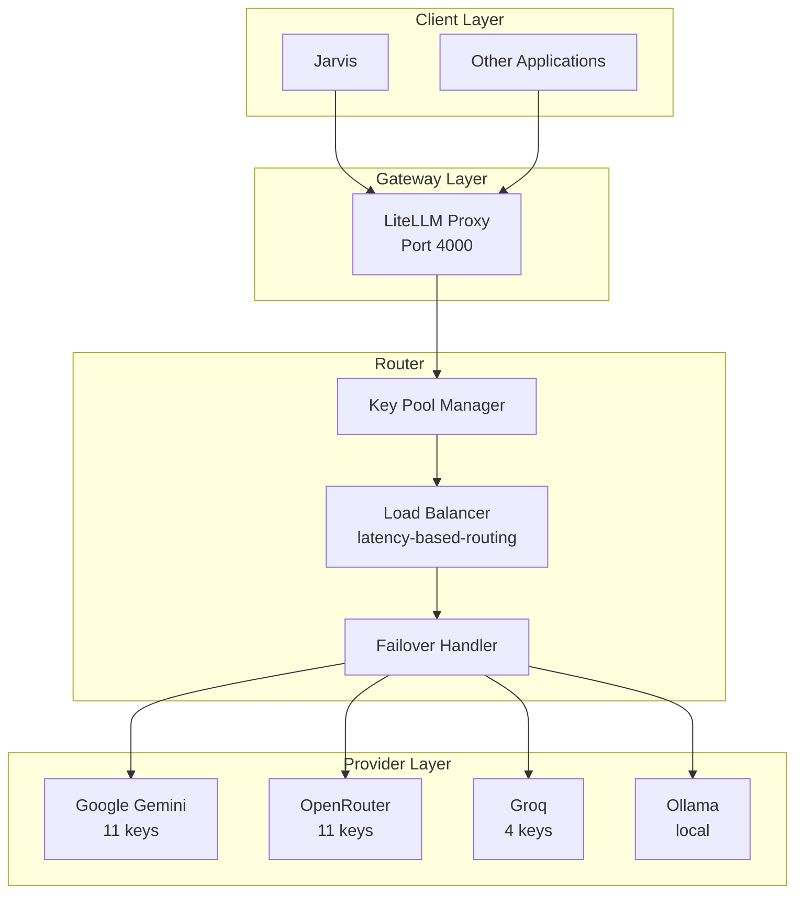

# LiteLLM Proxy - Jarvis Integration Schema

**Document Version:** 1.0.0
**Generated:** 2026-08-31
**Project:** LiteLLM Proxy Gateway

---

# Project Identity

## Canonical Name
`litellm-proxy`

## Legacy Identifiers
None - project has consistent naming throughout.

## Description
Minimal AI API gateway providing OpenAI-compatible interface with multi-provider load balancing, key pooling, and automatic failover.

## Primary Purpose
Serve as a unified LLM gateway that:
- Provides single OpenAI-compatible API endpoint
- Distributes requests across multiple API keys per model
- Handles automatic failover on rate limits/errors
- Supports multiple providers (Gemini, OpenRouter, Groq, Ollama)
- Abstracts provider-specific details from clients

## Role in Ecosystem
Infrastructure layer - acts as AI middleware between applications and LLM providers. Downstream projects should route all LLM calls through this proxy rather than calling providers directly.

## Technical Stack
- **Language:** Python 3.x (config generation scripts)
- **Core Runtime:** LiteLLM v1.72.6-stable (Docker)
- **Frameworks:** LiteLLM Proxy Server
- **Architecture:** Single-container stateless proxy

## Services
```
litellm-proxy (port 4000)
  └── LiteLLM Proxy Server
      ├── REST API (OpenAI-compatible)
      ├── Health endpoints
      └── Router with key pooling
```

## Ports
- `4000` - HTTP API (OpenAI-compatible /v1 endpoints)

## Containers
- `litellm-proxy` - Main proxy service

## Networks
- `litellm_public` - Bridge network for external access

## Databases
None - stateless operation. No persistence required.

## Storage
None - no volumes for persistent data.

## External Dependencies
- **Google Gemini API** - via GEMINI_API_KEY_* keys
- **OpenRouter API** - via OPENROUTER_API_KEY_* keys
- **Groq API** - via GROQ_API_KEY_* keys
- **Ollama** (optional) - local models via OLLAMA_API_BASE

## Cross-Project Dependencies
None - this is a foundational infrastructure service that other projects depend on.

---

# Jarvis Integration Summary

```yaml
project_id: litellm-proxy
integration_readiness: full

preferred_interface:
  type: rest
  base_url: http://localhost:4000/v1
  auth: Bearer token (LITELLM_MASTER_KEY)

supports:
  synchronous_commands: true
  async_jobs: false
  progress_tracking: false
  cancellation: false
  webhooks: false
  sse: false
  streaming_responses: true

primary_capabilities:
  - chat_completion
  - embedding_generation
  - model_listing
  - health_monitoring
  - configuration_management
  - diagnostics

operation_modes:
  - stateless_proxy
  - key_pooling
  - automatic_failover
  - load_balancing
```

## What Jarvis Can Do With This Project

1. **LLM Operations**
   - Send chat completion requests to any configured model
   - Generate embeddings (where model supports)
   - Stream responses for long-form generation
   - List available models

2. **Health & Monitoring**
   - Check proxy health/readiness
   - Run diagnostics
   - View container logs
   - Validate configuration

3. **Configuration Management**
   - Generate config from providers.yml
   - Validate configuration files
   - Add/remove API keys via .env
   - Restart service to pick up changes

4. **Operational Control**
   - Start/stop/restart proxy
   - View container status
   - Access container shell for debugging

## Interface Preferences

- **Primary:** REST API via OpenAI SDK or HTTP
- **Operational:** Makefile commands (make up/down/restart/logs)
- **Diagnostics:** Scripts (doctor.py, validate_config.py)

## Synchronous vs Asynchronous

All LLM operations are **synchronous HTTP requests**. The proxy itself handles:
- Request routing
- Key selection
- Failover retries
- Timeout management

No job IDs, no polling, no webhooks. Request completes when LLM responds or times out.

## Long-Running Operations

LLM requests can take 30-120+ seconds depending on:
- Model selected
- Provider latency
- Response length
- Rate limiting

Streaming responses available via `stream: true` parameter.

## Completion Detection

Request completes when HTTP response is received:
- `200` - Success
- `429` - Rate limited (after retries exhausted)
- `500/502/503` - Provider error
- Timeout - Request exceeded timeout limit

## High-Care Operations

- **`make clean`** - Deletes containers and volumes (destructive)
- **Adding/removing API keys** - Requires service restart
- **Changing LITELLM_MASTER_KEY** - Breaks all clients until updated
- **Modifying providers.yml** - Requires config regeneration and restart

---

# Capability Inventory

## Chat Completion

### Proposed Jarvis Tool Name
`litellm_proxy.chat.complete`

### Description
Send a chat completion request to any configured model. Supports streaming, function calling, and all OpenAI chat parameters.

### Interface Real
```
POST /v1/chat/completions
Authorization: Bearer <LITELLM_MASTER_KEY>
Content-Type: application/json
```

### Input

| Parameter | Type | Required | Default | Description |
|-----------|------|----------|---------|-------------|
| model | string | Yes | - | Model alias (e.g., "gemini-3.6-flash", "groq-llama4-scout") |
| messages | array | Yes | - | Array of message objects with role and content |
| max_tokens | integer | No | provider default | Maximum tokens to generate |
| temperature | number | No | 1.0 | Sampling temperature (0-2) |
| stream | boolean | No | false | Enable streaming responses |
| tools | array | No | null | Function tools for function calling |
| tool_choice | string/object | No | auto | Tool selection mode |
| top_p | number | No | 1.0 | Nucleus sampling |
| frequency_penalty | number | No | 0 | Frequency penalty |
| presence_penalty | number | No | 0 | Presence penalty |
| stop | string/array | No | null | Stop sequences |
| user | string | No | null | End-user identifier |

### Output
OpenAI-compatible ChatCompletion object:
```json
{
  "id": "chatcmpl-...",
  "object": "chat.completion",
  "created": 1234567890,
  "model": "gemini-3.6-flash",
  "choices": [{
    "index": 0,
    "message": {
      "role": "assistant",
      "content": "..."
    },
    "finish_reason": "stop"
  }],
  "usage": {
    "prompt_tokens": 10,
    "completion_tokens": 20,
    "total_tokens": 30
  }
}
```

### Side Effects
- Consumes API quota on upstream provider
- May trigger rate limit cooldown if failures occur
- Logs request metadata (not content) in LiteLLM logs

### Async Behavior
**Synchronous** - Request blocks until completion or timeout (30-120s typical).

### Tracking
No job tracking. Each request is independent.

### Completion Condition
HTTP 200 response received.

### Failure Conditions
- HTTP 429 - Rate limit exceeded after retries
- HTTP 401 - Invalid API key
- HTTP 400 - Invalid request parameters
- HTTP 500/502/503 - Provider error
- Timeout - Request exceeded configured timeout

### Retry Semantics
- **Automatic retry:** Yes, via LiteLLM router
- **Retry count:** 2 (configurable in providers.yml)
- **Cooldown on failure:** 60 seconds (configurable)
- **Failover:** Yes - tries next key in pool
- **Idempotency:** Request-level only, no idempotency keys

### Cancellation
Not supported. Once request sent, runs to completion or timeout.

### Risk Level
`SAFE_WRITE` - Consumes API quota but doesn't modify state.

---

## Embedding Generation

### Proposed Jarvis Tool Name
`litellm_proxy.embedding.create`

### Description
Generate embeddings for text input using configured embedding models.

### Interface Real
```
POST /v1/embeddings
Authorization: Bearer <LITELLM_MASTER_KEY>
Content-Type: application/json
```

### Input

| Parameter | Type | Required | Default | Description |
|-----------|------|----------|---------|-------------|
| model | string | Yes | - | Embedding model alias (e.g., "openrouter-embed-vl", "ollama-embed") |
| input | string/array | Yes | - | Text to embed |
| encoding_format | string | No | float | "float" or "base64" |

### Output
OpenAI-compatible Embedding object:
```json
{
  "object": "list",
  "data": [{
    "object": "embedding",
    "index": 0,
    "embedding": [0.1, 0.2, ...]
  }],
  "model": "openrouter-embed-vl",
  "usage": {
    "prompt_tokens": 10,
    "total_tokens": 10
  }
}
```

### Side Effects
- Consumes API quota on upstream provider

### Async Behavior
**Synchronous** - Typically faster than chat (1-5 seconds).

### Risk Level
`SAFE_WRITE`

---

## Model Listing

### Proposed Jarvis Tool Name
`litellm_proxy.models.list`

### Description
List all available models configured in the proxy.

### Interface Real
```
GET /v1/models
Authorization: Bearer <LITELLM_MASTER_KEY>
```

### Input
None

### Output
OpenAI-compatible Models list:
```json
{
  "object": "list",
  "data": [
    {
      "id": "gemini-3.6-flash",
      "object": "model",
      "created": 1234567890,
      "owned_by": "google"
    },
    ...
  ]
}
```

### Side Effects
None

### Async Behavior
**Synchronous** - Fast (< 1 second)

### Risk Level
`READ_ONLY`

---

## Health Check

### Proposed Jarvis Tool Name
`litellm_proxy.health.check`

### Description
Check if proxy is running and healthy.

### Interface Real
```
GET /health/readiness
```

### Input
None

### Output
- HTTP 200 with JSON body if healthy
- HTTP 503 if unhealthy

### What Jarvis Can Conclude
- **Confirms:** Proxy process alive, accepting connections
- **Does NOT confirm:** Upstream providers reachable, API keys valid

### Risk Level
`READ_ONLY`

---

## Proxy Startup

### Proposed Jarvis Tool Name
`litellm_proxy.service.start`

### Description
Start the LiteLLM proxy container.

### Interface Real
```bash
make up
```

Or directly:
```bash
python3 scripts/doctor.py --preflight
python3 scripts/generate_config.py
python3 scripts/validate_config.py config/litellm/config.yml
docker compose up -d
```

### Input
None (configuration from .env and providers.yml)

### Output
- Container started
- Health check passes
- "LiteLLM is ready" message

### Side Effects
- Starts Docker container
- Generates config.yml from providers.yml
- Validates configuration
- Binds port 4000

### Async Behavior
**Synchronous** - Waits up to 30 seconds for readiness.

### Completion Condition
Health check returns 200.

### Risk Level
`SAFE_WRITE`

---

## Proxy Shutdown

### Proposed Jarvis Tool Name
`litellm_proxy.service.stop`

### Description
Stop the LiteLLM proxy container.

### Interface Real
```bash
make down
```

Or:
```bash
docker compose down
```

### Side Effects
- Stops container
- Removes container (but not volumes)
- Releases port 4000

### Risk Level
`SAFE_WRITE`

---

## Proxy Restart

### Proposed Jarvis Tool Name
`litellm_proxy.service.restart`

### Description
Restart proxy with configuration regeneration.

### Interface Real
```bash
make restart
```

### Side Effects
- Regenerates config from providers.yml
- Validates configuration
- Recreates container
- Brief service interruption (5-10 seconds)

### Risk Level
`SAFE_WRITE`

---

## Configuration Generation

### Proposed Jarvis Tool Name
`litellm_proxy.config.generate`

### Description
Generate config.yml from providers.yml and discovered API keys.

### Interface Real
```bash
make generate-config
```

Or:
```bash
python3 scripts/generate_config.py
```

### Input
- `config/providers.yml` - Provider definitions
- `.env` - API keys

### Output
- `config/litellm/config.yml` - Generated LiteLLM configuration

### Side Effects
- Overwrites existing config.yml
- Discovers API keys by prefix pattern

### Risk Level
`SAFE_WRITE`

---

## Configuration Validation

### Proposed Jarvis Tool Name
`litellm_proxy.config.validate`

### Description
Validate generated configuration for errors.

### Interface Real
```bash
make validate
```

Or:
```bash
python3 scripts/validate_config.py config/litellm/config.yml
```

### Checks
- YAML validity
- Duplicate deployments
- Legacy settings
- Router configuration
- Model group summary

### Output
- Validation result (PASS/FAIL)
- Warnings if present
- Model group statistics

### Risk Level
`READ_ONLY`

---

## Diagnostics

### Proposed Jarvis Tool Name
`litellm_proxy.diagnostics.run`

### Description
Run comprehensive system diagnostics.

### Interface Real
```bash
make doctor
```

Or:
```bash
python3 scripts/doctor.py
```

### Checks
- .env file exists
- LITELLM_MASTER_KEY configured
- Provider keys configured
- Legacy variables detected
- Docker available
- Docker Compose available
- Port 4000 availability

### Output
- Status for each check
- Key counts per provider
- Warnings for issues

### Risk Level
`READ_ONLY`

---

## View Logs

### Proposed Jarvis Tool Name
`litellm_proxy.logs.view`

### Description
View proxy container logs.

### Interface Real
```bash
make logs
```

Or:
```bash
docker compose logs -f --tail=100
```

### Input
None (follows logs by default)

### Output
- Last 100 log lines
- Live streaming until interrupted

### Risk Level
`READ_ONLY`

---

## Container Cleanup

### Proposed Jarvis Tool Name
`litellm_proxy.service.clean`

### Description
Remove all containers and volumes (DESTRUCTIVE).

### Interface Real
```bash
make clean
```

### Side Effects
- Stops containers
- Removes volumes
- Removes orphaned containers
- **IRREVERSIBLE**

### Risk Level
`HIGH_RISK`

### Jarvis Should
- **NEVER** execute without explicit user confirmation
- Warn user this is destructive
- Require "yes" confirmation

---

# HTTP / API Surface

## OpenAI-Compatible Endpoints

### POST /v1/chat/completions
**Purpose:** Generate chat completion
**Auth:** Bearer token required
**Body:** OpenAI ChatCompletion request
**Response:** OpenAI ChatCompletion object
**Status Codes:**
- 200 - Success
- 400 - Invalid request
- 401 - Invalid API key
- 429 - Rate limit exceeded
- 500/502/503 - Provider error

**Source:** LiteLLM (external library)

### POST /v1/embeddings
**Purpose:** Generate embeddings
**Auth:** Bearer token required
**Body:** OpenAI Embeddings request
**Response:** OpenAI Embeddings object
**Status Codes:** Same as chat completions

**Source:** LiteLLM (external library)

### GET /v1/models
**Purpose:** List available models
**Auth:** Bearer token required
**Response:** OpenAI Models list

**Source:** LiteLLM (external library)

## Health Endpoints

### GET /health/readiness
**Purpose:** Check if proxy ready to accept requests
**Auth:** None
**Response:** JSON status object
**Status Codes:**
- 200 - Ready
- 503 - Not ready

**What it confirms:**
- LiteLLM process running
- API server accepting connections

**What it does NOT confirm:**
- Upstream providers reachable
- API keys valid
- Any specific model working

**Source:** LiteLLM (external library)

### GET /health/liveness
**Purpose:** Kubernetes-style liveness probe
**Auth:** None
**Response:** JSON status object

**Source:** LiteLLM (external library)

## Admin Endpoints

LiteLLM provides additional admin endpoints when authenticated with master key. These are available but not actively used by the current project:

### GET /key/info
**Purpose:** Get API key information
**Auth:** Master key required

### POST /key/generate
**Purpose:** Generate new API keys (not used in this deployment)

---

# Long-Running Operations and Workflow Model

## LLM Request Lifecycle

```
Client Request
      │
      ▼
LiteLLM Router
      │
      ├── Select key from pool (simple-shuffle or latency-based)
      │
      ▼
   Try Key 1
      │
      ├── Success ──► Return Response
      │
      ├── 429/Error ──► Cooldown key (60s)
      │
      ▼
   Try Key 2
      │
      ├── Success ──► Return Response
      │
      ├── 429/Error ──► Cooldown key
      │
      ▼
   Try Key N...
      │
      ├── All failed ──► Return Error
```

## Key Pooling Behavior

- **Strategy:** `latency-based-routing` (configured in providers.yml)
- **Pool size:** Varies by provider (e.g., 11 Gemini keys, 4 Groq keys)
- **Cooldown:** 60 seconds after `allowed_fails` (2) failures
- **Retry:** 2 attempts per request
- **Timeout:** 30-120 seconds depending on model

## No Job Tracking

This project does **not** implement:
- Job IDs
- Async job queues
- Progress tracking
- Webhook notifications
- Callback mechanisms

All operations are **synchronous HTTP requests**.

---

# Events and Notifications

## Current Implementation
**None** - No event system, webhooks, SSE, or message broker.

## Polling-Based Monitoring

Jarvis can poll:
- `GET /health/readiness` - Service health
- `docker compose ps` - Container status
- `docker compose logs` - Error detection

## Recommended Future Jarvis Events

```
litellm_proxy.service.started
litellm_proxy.service.stopped
litellm_proxy.service.unhealthy
litellm_proxy.key.cooldown
litellm_proxy.key.exhausted
litellm_proxy.provider.error
```

---

# Important Data Models

## Provider Configuration (providers.yml)

```yaml
providers:
  gemini:
    key_prefix: GEMINI_API_KEY_
    models:
      - name: gemini-3.6-flash
        model: gemini/gemini-3.6-flash
        mode: chat
        rpm: 15
        tpm: 3000000
        timeout: 60
        supports_function_calling: true
```

### Fields
- `key_prefix` - Environment variable prefix for key discovery
- `name` - Model alias used in API calls
- `model` - Provider-specific model identifier
- `mode` - "chat" or "embedding"
- `rpm` - Requests per minute limit
- `tpm` - Tokens per minute limit
- `timeout` - Request timeout in seconds

## Generated Deployment (config.yml)

```yaml
- model_name: gemini-3.6-flash
  litellm_params:
    model: gemini/gemini-3.6-flash
    api_key: os.environ/GEMINI_API_KEY_1
    rpm: 15
    tpm: 3000000
    timeout: 60
  model_info:
    mode: chat
    supports_function_calling: true
```

## Router Settings

```yaml
router_settings:
  routing_strategy: latency-based-routing
  num_retries: 2
  request_timeout: 90
  cooldown_time: 60
  allowed_fails: 2
  retry_after: 5
  enable_loadbalancing: false
```

---

# Authentication and Authorization

## Authentication Method
**API Key (Bearer Token)**

## Master Key
- **Environment Variable:** `LITELLM_MASTER_KEY`
- **Usage:** Required for all `/v1/*` endpoints
- **Header:** `Authorization: Bearer <LITELLM_MASTER_KEY>`

## Provider Keys
- **Discovery:** Automatic from `.env` by prefix pattern
- **Format:** `GEMINI_API_KEY_1`, `GEMINI_API_KEY_2`, etc.
- **Usage:** Internal only (never exposed to clients)

## No JWT/Session Auth
This deployment uses simple API key authentication.

## Public Endpoints
- `/health/readiness`
- `/health/liveness`

## Protected Endpoints
All `/v1/*` endpoints require Bearer token.

## Jarvis Service Account
Jarvis should use the `LITELLM_MASTER_KEY` for API calls. Store securely in Jarvis configuration.

---

# Runtime and Docker Integration

## Container Specification

```yaml
services:
  litellm:
    image: ghcr.io/berriai/litellm:v1.72.6-stable
    container_name: litellm-proxy
    restart: on-failure:5
    ports:
      - "4000:4000"
    volumes:
      - ./config/litellm/config.yml:/app/config.yml:ro
      - ./scripts/entrypoint.sh:/entrypoint.sh:ro
    env_file:
      - .env
    environment:
      LITELLM_MASTER_KEY: ${LITELLM_MASTER_KEY}
      LITELLM_PROXY_PORT: "4000"
      OLLAMA_API_BASE: ${OLLAMA_API_BASE:-http://host.docker.internal:11434}
    entrypoint: ["/bin/sh", "/entrypoint.sh"]
    command:
      - "--config"
      - "/app/config.yml"
      - "--port"
      - "4000"
      - "--num_workers"
      - "1"
      - "--telemetry"
      - "false"
    healthcheck:
      test: ["CMD-SHELL", "python3 -c 'import urllib.request; urllib.request.urlopen(\"http://localhost:4000/health/readiness\")'"]
      interval: 30s
      timeout: 10s
      retries: 3
      start_period: 30s
    deploy:
      resources:
        limits:
          memory: 512M
          cpus: '1.0'
```

## Operational Commands

### Check Status
```bash
docker compose ps
```

### View Logs
```bash
docker compose logs -f --tail=100
```

### Restart Service
```bash
docker compose restart
# or
make restart
```

### Shell Access
```bash
docker exec -it litellm-proxy /bin/sh
```

## Resource Limits
- **Memory:** 512MB limit
- **CPU:** 1.0 core limit
- **Idle RAM:** ~240MB

## Dangerous Operations

### ⚠️ `make clean`
**Effect:** Removes containers AND volumes
**Warning:** Irreversible
**Require:** Explicit user confirmation

### ⚠️ `docker compose down -v`
**Effect:** Same as `make clean`
**Warning:** Irreversible

### ⚠️ Modifying .env
**Effect:** Requires restart to take effect
**Risk:** Removing keys breaks functionality

---

# Health, Diagnostics and Troubleshooting

## Health Endpoints

### GET /health/readiness
**Confirms:**
- LiteLLM process alive
- API server listening
- Basic routing available

**Does NOT confirm:**
- Upstream providers reachable
- API keys valid
- Specific models working

### GET /health/liveness
**Confirms:**
- Process not deadlocked

## Diagnostic Script

```bash
make doctor
```

**Checks:**
1. `.env` file exists
2. `LITELLM_MASTER_KEY` set
3. At least one provider key configured
4. No legacy variables
5. Docker available
6. Docker Compose available
7. Port 4000 available

## Configuration Validation

```bash
make validate
```

**Checks:**
1. Valid YAML
2. No duplicate deployments
3. No problematic legacy settings
4. Reasonable router configuration
5. Model group summary

## Smoke Test

```bash
make test
```

**Runs:** `test_api.py` - sends actual request to configured model.

## Log Analysis

**Healthy startup indicators:**
- "Uvicorn running on http://0.0.0.0:4000"
- No Prisma/PostgreSQL errors
- No "DEBUG" logging

**Unhealthy indicators:**
- "No valid model list"
- "Failed to start"
- API key errors
- Connection refused to upstream

---

# CLI and Script Interfaces

## scripts/generate_config.py

**Purpose:** Generate LiteLLM config from providers.yml

**Usage:**
```bash
python3 scripts/generate_config.py
```

**Input:**
- `config/providers.yml`
- `.env` (for key discovery)

**Output:**
- `config/litellm/config.yml`

**Safe to run:** Yes (regenerates config)

---

## scripts/validate_config.py

**Purpose:** Validate generated configuration

**Usage:**
```bash
python3 scripts/validate_config.py [config_path]
```

**Safe to run:** Yes (read-only)

---

## scripts/doctor.py

**Purpose:** System diagnostics

**Usage:**
```bash
python3 scripts/doctor.py [--preflight]
```

**Flags:**
- `--preflight` - Run quick checks before startup (less verbose)

**Safe to run:** Yes (read-only)

---

## scripts/config_utils.py

**Purpose:** Shared utilities for config scripts

**Not directly executable** - imported by other scripts.

---

## scripts/entrypoint.sh

**Purpose:** Container entrypoint

**Actions:**
1. Neutralizes legacy environment variables
2. Sets log level to WARNING
3. Starts LiteLLM

**Not for direct execution** - used by Docker.

---

## scripts/healthcheck.sh

**Purpose:** Container health check script

**Usage:**
```bash
./scripts/healthcheck.sh
```

**Exit codes:**
- 0 - Healthy
- 1 - Unhealthy

---

# Filesystem, Storage and Generated Artifacts

## Configuration Files

| Path | Purpose | Modify via |
|------|---------|------------|
| `config/providers.yml` | Provider definitions | Manual edit |
| `config/litellm/config.yml` | Generated config | `make generate-config` |
| `.env` | API keys and secrets | Manual edit |
| `.env.example` | Template | Reference only |

## Generated Files

| Path | Generated by | Regenerated on |
|------|--------------|----------------|
| `config/litellm/config.yml` | `generate_config.py` | Every `make up/restart` |

## Logs

- Container logs: `docker compose logs`
- No persistent log files

## Temporary Files

None - stateless operation.

## Safe to Read
- All configuration files
- README.md
- makefile

## Safe to Modify
- `config/providers.yml` - edit to add/change models
- `.env` - edit to add/change API keys

## Require Restart After Modification
- `.env` changes
- `config/providers.yml` changes
- Run `make restart` to apply

---

# External and Cross-Project Dependencies

## Provider Dependencies

```
litellm-proxy
    │
    ├── Google Gemini API
    │   ├── Endpoint: generativelanguage.googleapis.com
    │   ├── Auth: GEMINI_API_KEY_*
    │   └── Models: gemini-3.6-flash, gemini-3.1-pro, gemini-3.5-flash-lite
    │
    ├── OpenRouter API
    │   ├── Endpoint: openrouter.ai/api/v1
    │   ├── Auth: OPENROUTER_API_KEY_*
    │   └── Models: 16+ models via OpenRouter
    │
    ├── Groq API
    │   ├── Endpoint: api.groq.com
    │   ├── Auth: GROQ_API_KEY_*
    │   └── Models: groq-llama4-scout, groq-llama3.3-70b, etc.
    │
    └── Ollama (optional)
        ├── Endpoint: OLLAMA_API_BASE (default: host.docker.internal:11434)
        ├── Auth: None
        └── Models: llama3.2-local, qwen-local, gemma-local, phi4-mini-local
```

## Behavior When Provider Unavailable

- Router attempts failover to other keys in pool
- If all keys fail: returns error to client
- Cooldown prevents repeated attempts to failing key

## No Downstream Dependencies

This project does not depend on other projects in the ecosystem. It is a foundational service.

---

# AI / LLM Integration

## Models Configured

### Google Gemini (11 keys each)
| Alias | Model | RPM | TPM | Timeout | Function Calling |
|-------|-------|-----|-----|---------|------------------|
| gemini-3.6-flash | gemini/gemini-3.6-flash | 15 | 3M | 60s | Yes |
| gemini-3.1-pro | gemini/gemini-3.1-pro-preview | 5 | 5M | 90s | Yes |
| gemini-3.5-flash-lite | gemini/gemini-3.5-flash-lite | 15 | 10M | 45s | Yes |

### OpenRouter (11 keys each)
| Alias | Model | Mode | Timeout |
|-------|-------|------|---------|
| openrouter-embed-vl | nvidia/llama-nemotron-embed-vl-1b-v2 | embedding | 30s |
| openrouter-gemma4-26b | google/gemma-4-26b-a4b | chat | 60s |
| openrouter-gemma4-31b | google/gemma-4-31b | chat | 60s |
| openrouter-gpt-oss-120b | openai/gpt-oss-120b | chat | 90s |
| openrouter-gpt-oss-20b | openai/gpt-oss-20b | chat | 60s |
| openrouter-laguna-m1 | poolside/laguna-m.1 | chat | 120s |
| openrouter-laguna-xs2 | poolside/laguna-xs.2 | chat | 60s |
| openrouter-nemotron-* | nvidia/nemotron-* | chat | 60-120s |
| openrouter-north-mini-code | cohere/north-mini-code | chat | 60s |
| openrouter-owl-alpha | openrouter/owl-alpha | chat | 90s |
| openrouter-seedream-4.5 | bytedance-seed/seedream-4.5 | chat | 120s |

### Groq (4 keys each)
| Alias | Model | RPM | TPM | Timeout |
|-------|-------|-----|-----|---------|
| groq-gpt-oss-120b | openai/gpt-oss-120b | 30 | 8K | 90s |
| groq-gpt-oss-20b | openai/gpt-oss-20b | 30 | 8K | 60s |
| groq-llama3.1-8b | llama-3.1-8b-instant | 30 | 6K | 30s |
| groq-llama3.3-70b | llama-3.3-70b-versatile | 30 | 12K | 90s |
| groq-llama4-scout | meta-llama/llama-4-scout-17b-16e-instruct | 30 | 30K | 60s |
| groq-qwen3-32b | qwen/qwen3-32b | 30 | 6K | 60s |
| groq-qwen3.6-27b | qwen/qwen3.6-27b | 30 | 8K | 60s |

### Ollama (local, no keys)
| Alias | Model | Timeout |
|-------|-------|---------|
| llama3.2-local | ollama/llama3.2 | 120s |
| qwen-local | ollama/qwen3.5:9b | 120s |
| gemma-local | ollama/gemma4:e4b | 120s |
| phi4-mini-local | ollama/phi4-mini | 120s |
| ollama-embed | ollama/mxbai-embed-large | - |
| qwen3.5-abliterated-local | ollama_chat/huihui_ai/qwen3.5-abliterated:9b | - |

## LLM Considerations

### Time-Consuming Operations
- Large model responses (120b models)
- Long-context requests
- Streaming responses

### Rate Limit Risk
- High request volume may trigger provider rate limits
- Key pooling mitigates this by distributing across keys

### GPU Requirements
None - all inference happens on provider infrastructure.

### External Dependencies
- All providers require internet connectivity
- Ollama requires local Ollama server running

---

# Recommended Jarvis Knowledge Resources

## Primary Documentation
| Path | Purpose |
|------|---------|
| `README.md` | Project overview and quick start |
| `config/providers.yml` | Model definitions and limits |

## Configuration
| Path | Purpose |
|------|---------|
| `config/providers.yml` | Source of truth for providers/models |
| `config/litellm/config.yml` | Generated config (do not edit directly) |
| `.env.example` | Environment template |

## Scripts
| Path | Purpose |
|------|---------|
| `scripts/generate_config.py` | Config generation logic |
| `scripts/validate_config.py` | Validation rules |
| `scripts/doctor.py` | Diagnostic checks |
| `scripts/config_utils.py` | Key discovery logic |
| `scripts/entrypoint.sh` | Container startup |

## Tests
| Path | Purpose |
|------|---------|
| `tests/test_routing_real.py` | Routing behavior validation |
| `tests/test_legacy_env.py` | Legacy variable neutralization |
| `test_api.py` | Smoke test example |

## Operations
| Path | Purpose |
|------|---------|
| `makefile` | All operational commands |
| `docker-compose.yml` | Container configuration |
| `scripts/healthcheck.sh` | Health check logic |

---

# Architecture for Jarvis Context

## System Architecture



## Request Flow

1. Client sends OpenAI-compatible request to `http://localhost:4000/v1/chat/completions`
2. LiteLLM authenticates via Bearer token
3. Router selects optimal key from pool based on strategy
4. Request forwarded to selected provider
5. On success: response returned to client
6. On failure: failover to next key, or return error

## Data Flow

```
Client Request → LiteLLM Router → Provider API → Response
                      │
                      ├── Key selection
                      ├── Rate limit handling
                      └── Retry logic
```

## Source of Truth
- `config/providers.yml` - Model definitions
- `.env` - API keys

## State Management
**Stateless** - no database, no session state, no persistence.

## Boundaries
- **Internal:** Config files, scripts
- **External:** Provider APIs (Gemini, OpenRouter, Groq, Ollama)
- **Client:** Any OpenAI SDK compatible application

---

# Jarvis Integration Gaps

## Gap 1: No Usage Metrics

### Description
No endpoint to query API usage, token counts, or cost tracking.

### Impact on Jarvis
Cannot answer "How much quota have we used?" or "What's the cost so far?"

### Recommended Solution
Add LiteLLM's built-in spend tracking or integrate with external monitoring.

### Priority
P2 - Nice to have for cost awareness

---

## Gap 2: No Key Health Status

### Description
No endpoint to query which keys are healthy vs. in cooldown.

### Impact on Jarvis
Cannot answer "Are all API keys working?" or "Which keys are rate-limited?"

### Recommended Solution
Expose LiteLLM's internal key health state via admin API.

### Priority
P2 - Useful for monitoring

---

## Gap 3: No Request Queuing

### Description
No job queue or async processing. All requests are synchronous.

### Impact on Jarvis
Cannot handle "queue this request and notify me when done" workflows.

### Recommended Solution
Add Redis-backed job queue if async workflows needed.

### Priority
P3 - Current sync model sufficient for most use cases

---

## Gap 4: No Webhook/Event System

### Description
No way to subscribe to events like "key exhausted" or "provider down".

### Impact on Jarvis
Must poll for health status rather than receiving push notifications.

### Recommended Solution
Add webhook configuration or message bus integration.

### Priority
P3 - Polling acceptable for current scale

---

## Gap 5: No Model Selection Guidance

### Description
No endpoint to query "which model should I use for X task?"

### Impact on Jarvis
Must rely on hardcoded knowledge or user specification.

### Recommended Solution
Add metadata in providers.yml about model capabilities and recommended use cases.

### Priority
P3 - Documentation can serve this purpose

---

## Gap 6: No Streaming Progress for Long Requests

### Description
Streaming responses available, but no structured progress events.

### Impact on Jarvis
Cannot report "50% complete" for long generations.

### Recommended Solution
Use existing streaming API and parse chunks for progress estimation.

### Priority
P3 - Streaming already provides incremental output

---

# Proposed Jarvis Capability Layer

```yaml
tools:
  - name: litellm_proxy.chat.complete
    description: Send chat completion request to any configured LLM
    risk: SAFE_WRITE
    async: false
    timeout_range: 30-120s

    maps_to:
      method: POST
      path: /v1/chat/completions

    input:
      model:
        type: string
        required: true
        description: Model alias (gemini-3.6-flash, groq-llama4-scout, etc.)
      messages:
        type: array
        required: true
        description: Conversation messages
      max_tokens:
        type: integer
        required: false
      temperature:
        type: number
        required: false
      stream:
        type: boolean
        required: false

    returns:
      content: string
      model: string
      usage:
        prompt_tokens: integer
        completion_tokens: integer

  - name: litellm_proxy.embedding.create
    description: Generate embeddings for text
    risk: SAFE_WRITE
    async: false

    maps_to:
      method: POST
      path: /v1/embeddings

    input:
      model:
        type: string
        required: true
      input:
        type: string
        required: true

    returns:
      embedding: array[float]

  - name: litellm_proxy.models.list
    description: List available models
    risk: READ_ONLY
    async: false

    maps_to:
      method: GET
      path: /v1/models

  - name: litellm_proxy.health.check
    description: Check proxy health
    risk: READ_ONLY
    async: false

    maps_to:
      method: GET
      path: /health/readiness

  - name: litellm_proxy.service.start
    description: Start proxy service
    risk: SAFE_WRITE
    async: false
    timeout: 60s

    maps_to:
      command: make up

    completion:
      check: GET /health/readiness
      expect: 200

  - name: litellm_proxy.service.stop
    description: Stop proxy service
    risk: SAFE_WRITE
    async: false

    maps_to:
      command: make down

  - name: litellm_proxy.service.restart
    description: Restart proxy service
    risk: SAFE_WRITE
    async: false
    timeout: 60s

    maps_to:
      command: make restart

    completion:
      check: GET /health/readiness
      expect: 200

  - name: litellm_proxy.diagnostics.run
    description: Run system diagnostics
    risk: READ_ONLY
    async: false

    maps_to:
      command: make doctor

  - name: litellm_proxy.logs.view
    description: View container logs
    risk: READ_ONLY
    async: false

    maps_to:
      command: make logs

  - name: litellm_proxy.config.generate
    description: Generate config from providers.yml
    risk: SAFE_WRITE
    async: false

    maps_to:
      command: make generate-config

  - name: litellm_proxy.config.validate
    description: Validate configuration
    risk: READ_ONLY
    async: false

    maps_to:
      command: make validate
```

---

# MCP Integration Assessment

## MCP Suitability
**MEDIUM**

LiteLLM Proxy is well-suited for MCP integration as it provides a clean API for LLM operations.

## Candidate MCP Tools

```
litellm_chat_complete
  - Send chat completion to any configured model

litellm_embedding_create
  - Generate embeddings

litellm_models_list
  - List available models

litellm_health_check
  - Check proxy status
```

## Candidate MCP Resources

```
litellm://models
  - List of configured models with capabilities

litellm://config
  - Current provider configuration (sanitized)

litellm://health
  - Current health status

litellm://providers
  - Provider definitions and limits
```

## Candidate MCP Prompts

```
litellm://prompts/recommend_model
  - "Given task X, which model should I use?"

litellm://prompts/troubleshoot
  - "Why is my request failing?"
```

---

# Jarvis Safety Classification

## READ_ONLY
- `GET /v1/models`
- `GET /health/readiness`
- `GET /health/liveness`
- `make doctor`
- `make validate`
- `make logs`
- `make ps`

## SAFE_WRITE
- `POST /v1/chat/completions` (consumes quota)
- `POST /v1/embeddings` (consumes quota)
- `make up`
- `make down`
- `make restart`
- `make generate-config`

## CODE_WRITE
- Editing `config/providers.yml`
- Editing `.env`
- Adding/removing API keys

## HIGH_RISK
- `make clean` - **REQUIRES CONFIRMATION**
- `docker compose down -v` - **REQUIRES CONFIRMATION**
- Removing API keys without restart
- Changing LITELLM_MASTER_KEY

---

# Recommended Jarvis Integration Roadmap

## Phase 1 — Minimum Useful Integration

**Capabilities:**
1. Chat completion (`litellm_proxy.chat.complete`)
2. Model listing (`litellm_proxy.models.list`)
3. Health check (`litellm_proxy.health.check`)
4. Basic logs (`litellm_proxy.logs.view`)

**Use Cases:**
- Jarvis can answer questions using configured LLMs
- Jarvis can check if service is running
- Jarvis can list available models

**Effort:** Low - direct API mapping

---

## Phase 2 — Operational Control

**Capabilities:**
1. Service start/stop/restart
2. Configuration validation
3. Diagnostics
4. Config generation

**Use Cases:**
- Jarvis can manage the service lifecycle
- Jarvis can diagnose issues
- Jarvis can update configuration

**Effort:** Medium - command execution with status checks

---

## Phase 3 — Advanced Integration

**Capabilities:**
1. MCP server implementation
2. Usage metrics (if added)
3. Key health monitoring (if added)
4. Embedding support

**Use Cases:**
- Jarvis exposes LiteLLM via MCP to other tools
- Jarvis monitors quota usage
- Jarvis tracks key health

**Effort:** Higher - requires code changes or MCP adapter

---

# Jarvis Quick Reference

## Capability Summary

| Capability | Jarvis Tool | Current Interface | Async | Risk |
|------------|-------------|-------------------|-------|------|
| Chat completion | litellm_proxy.chat.complete | POST /v1/chat/completions | No | SAFE_WRITE |
| Embeddings | litellm_proxy.embedding.create | POST /v1/embeddings | No | SAFE_WRITE |
| List models | litellm_proxy.models.list | GET /v1/models | No | READ_ONLY |
| Health check | litellm_proxy.health.check | GET /health/readiness | No | READ_ONLY |
| Start service | litellm_proxy.service.start | make up | No | SAFE_WRITE |
| Stop service | litellm_proxy.service.stop | make down | No | SAFE_WRITE |
| Restart service | litellm_proxy.service.restart | make restart | No | SAFE_WRITE |
| View logs | litellm_proxy.logs.view | make logs | No | READ_ONLY |
| Diagnostics | litellm_proxy.diagnostics.run | make doctor | No | READ_ONLY |
| Generate config | litellm_proxy.config.generate | make generate-config | No | SAFE_WRITE |
| Validate config | litellm_proxy.config.validate | make validate | No | READ_ONLY |
| Clean up | litellm_proxy.service.clean | make clean | No | HIGH_RISK |

## Base URLs
- **API:** `http://localhost:4000/v1`
- **Health:** `http://localhost:4000/health`

## Important Ports
- `4000` - HTTP API

## Main Services
- `litellm-proxy` - Docker container

## Health Checks
- `GET /health/readiness` - Service ready
- `make health` - Script check
- `make doctor` - Full diagnostics

## Authentication
- Header: `Authorization: Bearer <LITELLM_MASTER_KEY>`
- Key stored in `.env` as `LITELLM_MASTER_KEY`

## Job Status
Not applicable - all operations synchronous.

## Primary Identifiers
- `model` - Model alias (e.g., "gemini-3.6-flash")
- No job IDs, run IDs, or workflow IDs

## Important Storage Paths
- `config/providers.yml` - Source of truth for models
- `.env` - API keys (DO NOT COMMIT)
- `config/litellm/config.yml` - Generated config

## Relevant Environment Variables

| Variable | Purpose | Required |
|----------|---------|----------|
| LITELLM_MASTER_KEY | Proxy authentication | Yes |
| GEMINI_API_KEY_* | Gemini API keys | No |
| OPENROUTER_API_KEY_* | OpenRouter API keys | No |
| GROQ_API_KEY_* | Groq API keys | No |
| OLLAMA_API_BASE | Ollama server URL | No |

## Makefile Commands Quick Reference

| Command | Description | Risk |
|---------|-------------|------|
| `make up` | Start proxy | SAFE |
| `make down` | Stop proxy | SAFE |
| `make restart` | Restart proxy | SAFE |
| `make logs` | View logs | SAFE |
| `make ps` | Container status | SAFE |
| `make health` | Check health | SAFE |
| `make doctor` | Run diagnostics | SAFE |
| `make test` | Smoke test | SAFE |
| `make generate-config` | Generate config | SAFE |
| `make validate` | Validate config | SAFE |
| `make clean` | Remove all | HIGH_RISK |

---

# Document Metadata

**Generated by:** Jarvis Integration Analysis
**Date:** 2026-08-31
**Repository:** /home/bernardo/workspaces/litellm-proxy
**Commit:** 4e40956 (feat: enhancements)

**Capabilities Documented:** 12
**Models Configured:** 35+
**Providers Supported:** 4 (Gemini, OpenRouter, Groq, Ollama)

**Integration Gaps Identified:** 6
**Priority P0 Gaps:** 0
**Priority P1 Gaps:** 0
**Priority P2 Gaps:** 2
**Priority P3 Gaps:** 4
